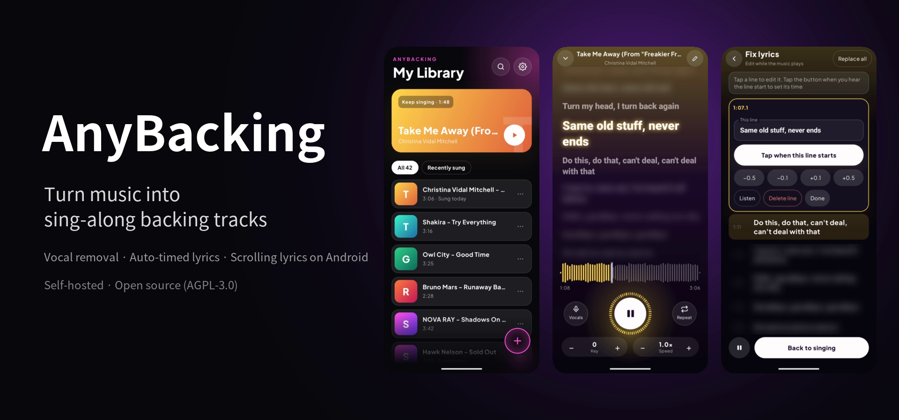
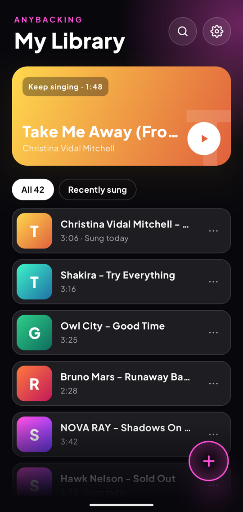
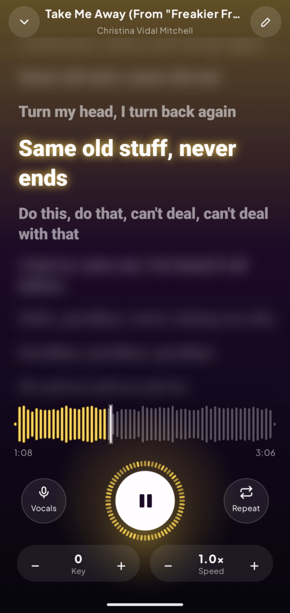
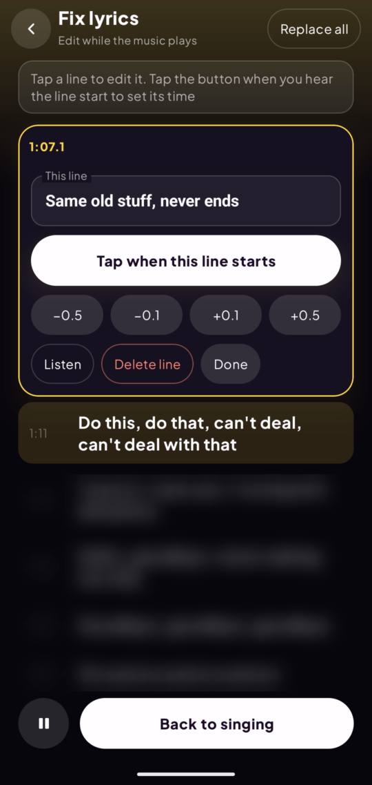
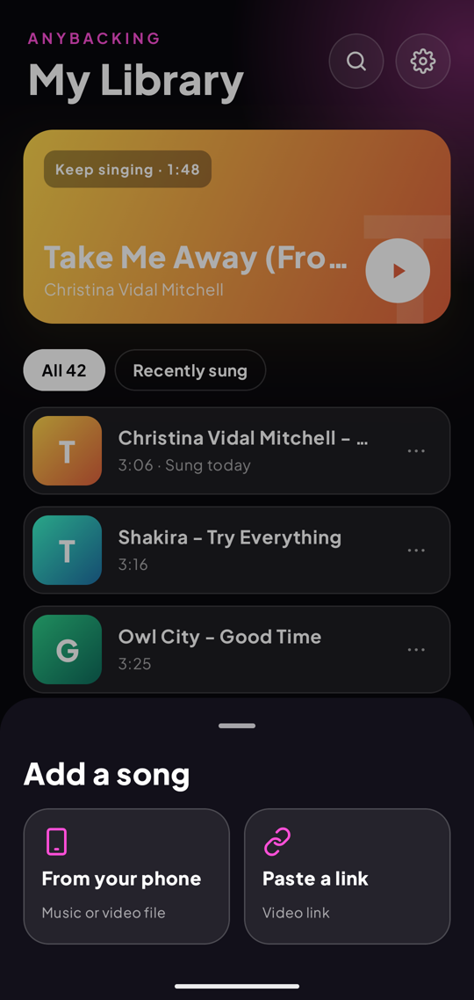
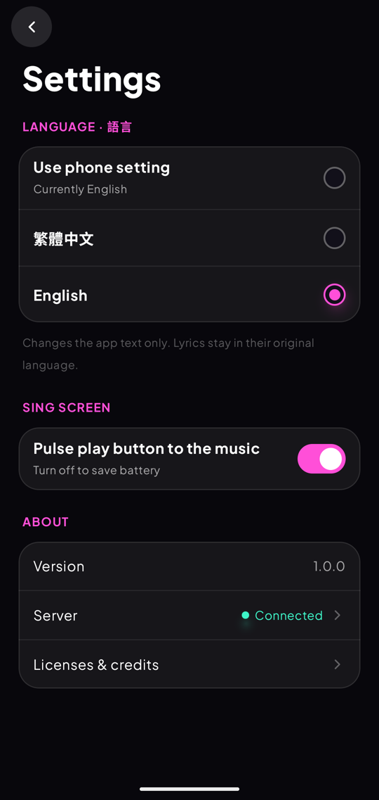

# AnyBacking（伴唱工坊）

**Turn music into sing-along backing tracks, on your own computer.**
Upload a song (or paste a video link) → AI removes the vocals, finds and times the lyrics → sing along on your Android phone with scrolling lyrics.

[中文說明 README.zh-TW.md](README.zh-TW.md)



- **Vocal removal** with MelBand RoFormer (Kim) — optional BS-RoFormer (viperx)
- **Lyrics**: synced lyrics from LRCLIB, lyrics sites found through a bundled search engine, or Whisper speech recognition; every candidate is checked against what is actually sung, then timed line by line
- **Android app**: scrolling lyrics, original-vocal volume, key (±6 semitones) and speed, A–B loop over a waveform, background playback, fix a line's text or timing with one tap
- **Command line**: render a karaoke video (MP4, two audio tracks) from a file or link

> **Personal, self-hosted tool.** You run the server for yourself; nothing is hosted by us.
> Only process music you have the right to use. Song recordings and lyrics are copyrighted —
> don't share what you make. Downloading from YouTube may break its Terms of Service; that choice is yours.
> This project is not affiliated with YouTube, LRCLIB or any lyrics site.

## Screenshots

| Library | Sing along | Fix a line | Add a song | Settings |
|---|---|---|---|---|
|  |  |  |  |  |

<sub>Lyrics blurred except the current lines.</sub>

---

## Requirements

Measured on the author's machine (RTX 4060 8 GB, 4-minute songs).

| | Minimum | Recommended |
|---|---|---|
| GPU | NVIDIA with **8 GB** VRAM (CUDA) | NVIDIA 8 GB or more |
| RAM | 16 GB | 32 GB |
| Free disk | 20 GB | 50 GB+ |
| OS | Linux with NVIDIA Container Toolkit, or Windows 10/11 with Docker Desktop (WSL2) | |
| Phone | Android 13 or newer (64-bit ARM) | |

- One processing run peaks at about 5–7.5 GB of GPU memory and 9 GB of RAM; a 4-minute song takes about 2 minutes.
  GPUs with less than 8 GB are untested.
- Disk: Docker image ~8 GB, AI models ~5 GB (downloaded on first use), about 30 MB per song.
- **Not supported**: AMD / Intel GPUs, Apple Silicon, computers without a GPU (the command line has a slow CPU mode; the app server needs CUDA).
- The models are loaded only while a song is being processed, so an idle server leaves the GPU free for other things.

## Quick start

### 1. Prepare the computer

**Linux**: install the NVIDIA driver, Docker Engine with the Compose plugin, and the
[NVIDIA Container Toolkit](https://docs.nvidia.com/datacenter/cloud-native/container-toolkit/latest/install-guide.html), then
`sudo nvidia-ctk runtime configure --runtime=docker && sudo systemctl restart docker`.

**Windows**: install the latest NVIDIA driver and Docker Desktop (WSL2 backend).

Check that Docker sees the GPU:

```bash
docker run --rm --gpus all nvidia/cuda:12.4.1-base-ubuntu22.04 nvidia-smi
```

### 2. Start the server

```bash
git clone https://github.com/DaiMoO-Studio/AnyBacking.git
cd AnyBacking
cp .env.example .env        # then replace the three change-me values with random strings
docker compose build        # 10–20 minutes the first time
docker compose up -d        # database, API, GPU worker, lyrics search, daily backup
```

Everything restarts by itself after a reboot.

### 3. Give your phone a key

```bash
docker compose exec api python /app/auth.py issue "My phone"
```

The key (`ab_…`) is shown only once. Send it to your phone (e.g. a note to yourself) so you can paste it.
`auth.py list` shows keys, `auth.py revoke "My phone"` cancels one immediately.
On Windows git-bash, prefix the command with `MSYS_NO_PATHCONV=1`.

### 4. Install the app

Download `AnyBacking-x.y.z.apk` from [Releases](https://github.com/DaiMoO-Studio/AnyBacking/releases) and install it
(allow “install unknown apps” for your browser or file manager). On first launch, enter:

- **Server address**: `http://<this computer's local IP>:8000`, e.g. `http://192.168.1.20:8000`
- **Device key**: the `ab_…` key from step 3

The phone must be on the same Wi-Fi as the computer.

**Windows: let the phone in.** Windows Firewall blocks connections from other devices by default. Once, in PowerShell **as administrator**:

```powershell
New-NetFirewallRule -DisplayName "AnyBacking" -Direction Inbound -Protocol TCP -LocalPort 8000 -Action Allow -Profile Private
```

and make sure your home network is set to *Private* (Settings → Network & internet → your Wi-Fi or Ethernet → Network profile type → Private).
Check from the phone's browser: `http://<computer IP>:8000/api/health` should show `{"ok":true}`.

## Using it away from home

Don't open port 8000 to the internet. Two safe options:

- **Tailscale** (easiest): install it on the computer and the phone, then use `http://<the computer's Tailscale IP>:8000`
  (`100.x.y.z`). Plain http is allowed only for home-network and Tailscale addresses.
- **Your own domain**: put a reverse proxy with a real HTTPS certificate (e.g. Caddy) in front of the API, forward `/api/*`
  to port 8000, set `API_BIND=127.0.0.1` in `.env`, and use `https://your.domain` in the app.

## Configuration (`.env`)

| Setting | Default | |
|---|---|---|
| `POSTGRES_PASSWORD`, `MEDIA_SECRET`, `SEARXNG_SECRET` | — | Required, random strings |
| `API_BIND` / `API_PORT` | `0.0.0.0` / `8000` | Where the API listens |
| `URL_IMPORT` | `1` | Paste video links instead of uploading files (yt-dlp). `0` turns it off |
| `WEB_LYRICS` | `1` | Search lyrics sites when LRCLIB has no synced lyrics. `0` turns it off |
| `BACKUP_DIR` | `./data/backups` | Daily backup at 03:30 (database + songs), 14 kept |
| `TZ` | `UTC` | Log time zone (POSIX form, e.g. `CST-8`) |
| `WORKER_NAME` | `worker` | Keep it fixed; unfinished jobs are resumed by name |

The vocal-removal model is set by `SEP_MODEL` in `docker-compose.yml`: `vocals_mel_band_roformer.ckpt` (Kim, default)
or `model_bs_roformer_ep_317_sdr_12.9755.ckpt` (viperx, slightly cleaner, about 3× slower).

## Updating

```bash
git pull
docker compose build        # also picks up the newest yt-dlp when video links stop working
docker compose up -d
```

Install the new APK over the old one; your songs and settings stay.

## Backups

Backups run every day at 03:30 into `BACKUP_DIR`. Run one now with
`docker compose exec backup sh /scripts/backup.sh`. To restore:

```bash
docker compose stop api worker
docker compose exec -T db pg_restore -U anybacking -d anybacking --clean --if-exists < <backup>/db.dump
mv data/storage/songs data/storage/songs.old && tar -xf <backup>/storage.tar -C data/storage
docker compose up -d
```

## Command line: karaoke videos

Makes an MP4 with burned-in lyrics and two audio tracks (backing / backing + quiet guide vocal):

```bash
docker compose run --rm cli /data/input/song.mp3            # put files in ./input/
docker compose run --rm cli "<video link>"
docker compose run --rm cli /data/input/song.mp3 --lyrics /data/input/song.lrc
docker compose run --rm cli --rerender "/data/output/<folder>"   # after editing lyrics.lrc or words.json
```

Output goes to `data/output/<title> [<id>]/`. The command line uses the viperx model by default (`--sep-model` to change). `--style karaoke` gives two-line KTV highlighting, `--key -2` shifts the key,
`--commercial` uses only components whose licenses allow commercial use (Kim model, no links, no LRCLIB).
`docker compose run --rm cli --help` lists everything.

## Building the app yourself

See [android/README.md](android/README.md) (Docker only, no Android Studio needed).
Without `android/server.properties` the app starts with an empty server address, like the release APK.

## Licenses

AnyBacking is licensed under the **GNU AGPL-3.0** ([LICENSE](LICENSE)): you may use, change and share it; if you run a
modified version as a network service for others, you must publish your changes.

The AI models are downloaded at run time and have their **own** licenses — see [THIRD_PARTY.md](THIRD_PARTY.md).
In short: Kim MelBand RoFormer (default) is MIT; the viperx BS-RoFormer weights carry no license statement; Whisper is MIT;
Demucs weights are research-only and are not used.

## Support

A personal project shared as-is, without warranty or guaranteed support. Bug reports are welcome; replies may be slow.
