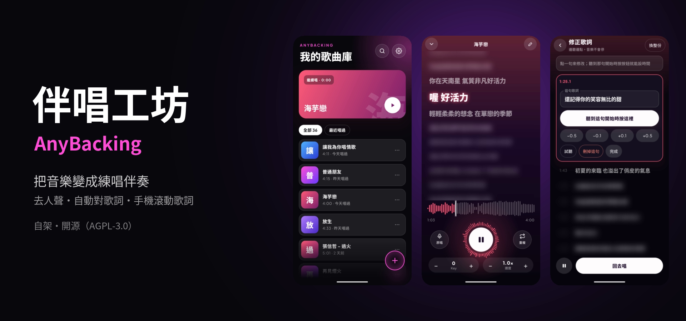
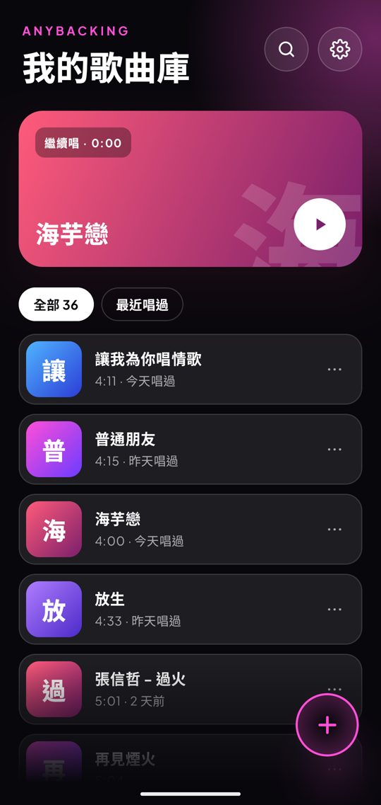
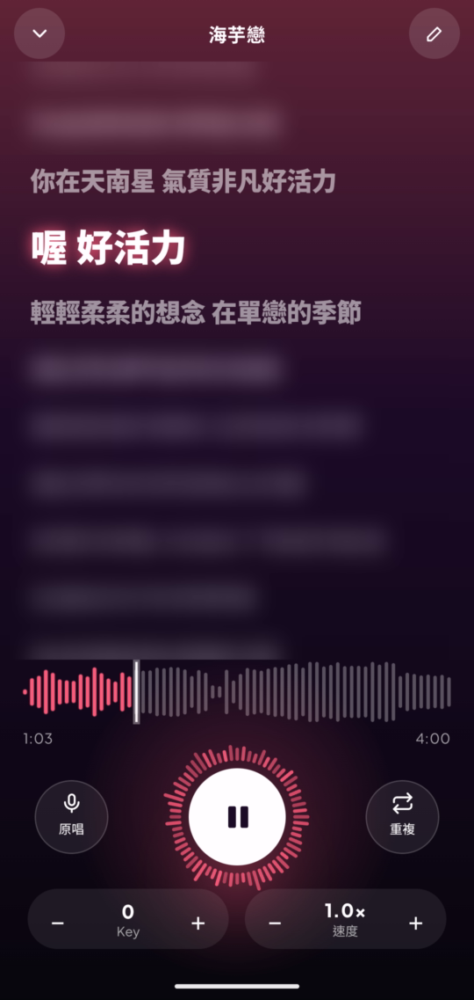
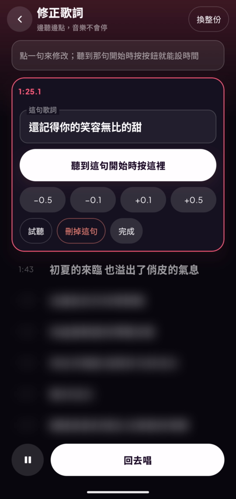
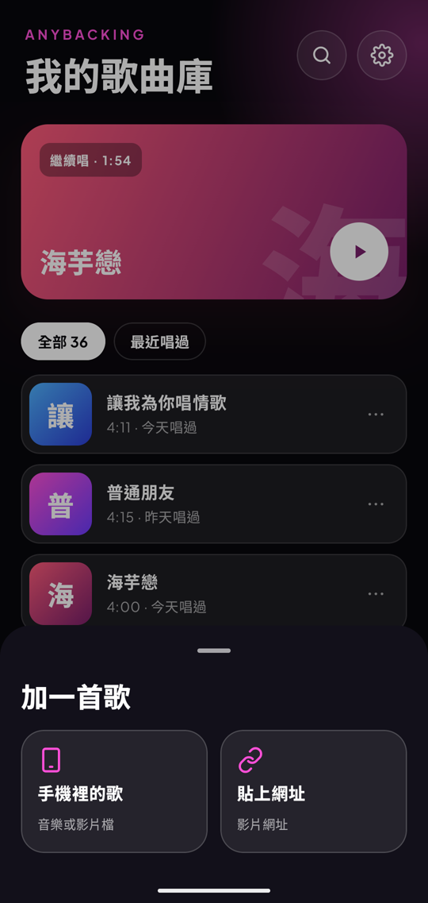
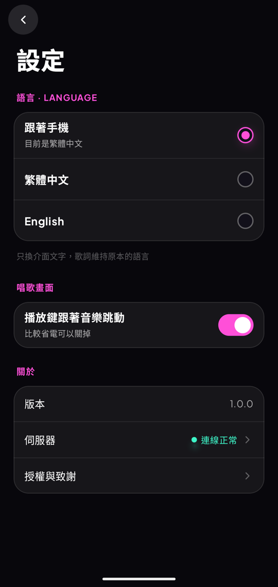

# 伴唱工坊 AnyBacking

**在自己的電腦上，把音樂變成練唱伴奏。**
上傳一首歌（或貼影片網址）→ AI 去人聲、找歌詞並對好時間 → 在 Android 手機上跟著滾動歌詞唱。

[English README](README.md)



- **去人聲**：MelBand RoFormer（Kim），可改用 BS-RoFormer（viperx）
- **歌詞**：LRCLIB 同步歌詞、內建搜尋引擎找到的歌詞網站、或 Whisper 語音辨識；每份候選都和實際唱的內容比對，挑最像的再逐句對時間
- **Android App**：滾動歌詞、原唱音量、升降 Key（±6 半音）與變速、在波形上選段循環、背景播放、一點就能修正某句的字或時間
- **命令列**：把檔案或影片網址做成 KTV 影片（MP4，伴唱／導唱兩條音軌）

> **個人自架工具。** 伺服器由你自己架、只給自己用；我們不代管任何服務。
> 請只處理你有權使用的音樂。歌曲錄音與歌詞受著作權保護，做出來的東西請不要散布。
> 從 YouTube 下載可能違反其服務條款，是否使用由你自行決定。本專案與 YouTube、LRCLIB 或任何歌詞網站無關。

## 截圖

| 歌曲庫 | 唱歌 | 修正一句 | 加歌 | 設定 |
|---|---|---|---|---|
|  |  |  |  |  |

<sub>歌詞除了目前這幾句都已模糊處理。</sub>

---

## 硬體需求

作者的電腦實測（RTX 4060 8 GB、4 分鐘的歌）。

| | 最低 | 建議 |
|---|---|---|
| 顯示卡 | NVIDIA，顯示卡記憶體 **8 GB**（CUDA） | NVIDIA 8 GB 以上 |
| 系統記憶體 | 16 GB | 32 GB |
| 硬碟可用空間 | 20 GB | 50 GB 以上 |
| 作業系統 | Linux＋NVIDIA Container Toolkit，或 Windows 10／11＋Docker Desktop（WSL2） | |
| 手機 | Android 13 以上（64 位元 ARM） | |

- 處理一首歌時，顯示卡記憶體最高約 5～7.5 GB、系統記憶體約 9 GB；4 分鐘的歌約 2 分鐘處理完。8 GB 以下的顯示卡沒有測過。
- 硬碟：Docker 映像約 8 GB、AI 模型約 5 GB（第一次使用時下載）、每首歌約 30 MB。
- **不支援**：AMD／Intel 顯示卡、Apple Silicon、沒有顯示卡的電腦（命令列有很慢的 CPU 模式，App 的伺服器需要 CUDA）。
- 模型只在處理歌曲時載入；伺服器閒置時不佔顯示卡，可以照常玩遊戲、跑其他 AI。

## 快速開始

### 1. 準備電腦

**Linux**：安裝 NVIDIA 驅動、Docker Engine（含 Compose plugin）、
[NVIDIA Container Toolkit](https://docs.nvidia.com/datacenter/cloud-native/container-toolkit/latest/install-guide.html)，再執行
`sudo nvidia-ctk runtime configure --runtime=docker && sudo systemctl restart docker`。

**Windows**：安裝最新的 NVIDIA 驅動與 Docker Desktop（WSL2）。

確認 Docker 看得到顯示卡：

```bash
docker run --rm --gpus all nvidia/cuda:12.4.1-base-ubuntu22.04 nvidia-smi
```

### 2. 啟動伺服器

```bash
git clone https://github.com/DaiMoO-Studio/AnyBacking.git
cd AnyBacking
cp .env.example .env        # 把三個 change-me 換成隨機字串
docker compose build        # 第一次約 10～20 分鐘
docker compose up -d        # 資料庫、API、GPU 工作機、歌詞搜尋、每日備份
```

電腦重開機後會自動啟動。

### 3. 幫手機核發金鑰

```bash
docker compose exec api python /app/auth.py issue "我的手機"
```

金鑰（`ab_…`）只會顯示這一次，傳到手機上（例如傳訊息給自己）方便貼上。
`auth.py list` 列出金鑰，`auth.py revoke "我的手機"` 立刻撤銷。Windows 的 git-bash 要在指令前加 `MSYS_NO_PATHCONV=1`。

### 4. 安裝 App

到 [Releases](https://github.com/DaiMoO-Studio/AnyBacking/releases) 下載 `AnyBacking-x.y.z.apk` 安裝
（瀏覽器或檔案管理員要允許「安裝不明應用程式」）。第一次開啟時填：

- **伺服器位址**：`http://<這台電腦的區網 IP>:8000`，例如 `http://192.168.1.20:8000`
- **裝置金鑰**：步驟 3 的 `ab_…`

手機要和電腦連同一個 Wi-Fi。

**Windows：讓手機連得進來。** Windows 防火牆預設擋住其他裝置連進來，要用**系統管理員身分**開 PowerShell 執行一次：

```powershell
New-NetFirewallRule -DisplayName "AnyBacking" -Direction Inbound -Protocol TCP -LocalPort 8000 -Action Allow -Profile Private
```

並確認家裡的網路設成「私人」（設定 → 網路和網際網路 → 你的 Wi-Fi 或乙太網路 → 網路設定檔類型 → 私人網路）。
用手機瀏覽器開 `http://<電腦 IP>:8000/api/health`，看到 `{"ok":true}` 就是通了。

## 在外面也要用

不要把 8000 port 直接開到網際網路上。兩種安全的做法：

- **Tailscale**（最簡單）：電腦和手機都裝，App 填 `http://<電腦的 Tailscale IP>:8000`（`100.x.y.z`）。
  App 只允許家裡區網和 Tailscale 的位址用 http。
- **自己的網域**：在 API 前面放有正式 HTTPS 憑證的反向代理（例如 Caddy），把 `/api/*` 轉到 8000，`.env` 設 `API_BIND=127.0.0.1`，
  App 填 `https://你的網域`。

## 設定（`.env`）

| 設定 | 預設 | |
|---|---|---|
| `POSTGRES_PASSWORD`、`MEDIA_SECRET`、`SEARXNG_SECRET` | — | 必填，隨機字串 |
| `API_BIND`／`API_PORT` | `0.0.0.0`／`8000` | API 聽哪裡 |
| `URL_IMPORT` | `1` | 可以貼影片網址（yt-dlp）；`0` 關閉 |
| `WEB_LYRICS` | `1` | LRCLIB 沒有同步歌詞時上網找歌詞；`0` 關閉 |
| `BACKUP_DIR` | `./data/backups` | 每天 03:30 備份（資料庫＋歌曲），保留 14 份 |
| `TZ` | `UTC` | 日誌時區（POSIX 寫法，台北是 `CST-8`） |
| `WORKER_NAME` | `worker` | 固定不要改；重開後靠名稱接續沒做完的工作 |

去人聲模型在 `docker-compose.yml` 的 `SEP_MODEL`：`vocals_mel_band_roformer.ckpt`（Kim，預設）
或 `model_bs_roformer_ep_317_sdr_12.9755.ckpt`（viperx，略乾淨、慢約 3 倍）。

## 更新

```bash
git pull
docker compose build        # 影片網址突然不能用時，重建也會更新 yt-dlp
docker compose up -d
```

新版 APK 直接覆蓋安裝，歌曲和設定都會保留。

## 備份

每天 03:30 自動備份到 `BACKUP_DIR`；馬上備份一次：`docker compose exec backup sh /scripts/backup.sh`。還原：

```bash
docker compose stop api worker
docker compose exec -T db pg_restore -U anybacking -d anybacking --clean --if-exists < <備份>/db.dump
mv data/storage/songs data/storage/songs.old && tar -xf <備份>/storage.tar -C data/storage
docker compose up -d
```

## 命令列：做 KTV 影片

產生燒好字幕、兩條音軌（伴唱／伴唱＋小聲原唱）的 MP4：

```bash
docker compose run --rm cli /data/input/song.mp3            # 檔案放在 ./input/
docker compose run --rm cli "<影片網址>"
docker compose run --rm cli /data/input/song.mp3 --lyrics /data/input/song.lrc
docker compose run --rm cli --rerender "/data/output/<資料夾>"   # 改過 lyrics.lrc 或 words.json 之後
```

輸出在 `data/output/<標題> [<id>]/`。命令列預設用 viperx 模型（`--sep-model` 可換）。`--style karaoke` 是上下兩行逐字變色，
`--key -2` 降 Key，`--commercial` 只用授權允許商用的元件（Kim 模型、不收網址、不查 LRCLIB）。完整參數：`docker compose run --rm cli --help`。

## 自己建置 App

見 [android/README.md](android/README.md)（只要 Docker，不需要 Android Studio）。
沒有 `android/server.properties` 時，App 一開始的伺服器位址是空的，和發布的 APK 一樣。

## 授權

本專案採 **GNU AGPL-3.0**（[LICENSE](LICENSE)）：可以使用、修改、分享；如果把修改過的版本架成網路服務給別人用，必須公開你的修改。

AI 模型在執行時才下載，有**各自的**授權，見 [THIRD_PARTY.md](THIRD_PARTY.md)。簡單說：Kim MelBand RoFormer（預設）是 MIT；
viperx BS-RoFormer 的權重沒有授權聲明；Whisper 是 MIT；Demucs 的權重只限研究，本專案不使用。

## 支援

個人專案，照現狀分享，不提供保證或固定的支援。歡迎回報問題，但回覆可能比較慢。
